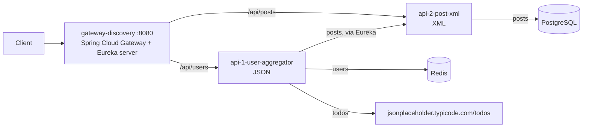

# Spring Boot Microservices Assessment

Two Spring Boot REST APIs behind a gateway with service discovery, packaged as five Docker Compose
services. API 1 combines users, todos and posts into one JSON response; API 2 serves posts as XML.

## Run it

Requirements: Docker with Compose v2, and port 8080 free (set `GATEWAY_PORT` to use another one).

```bash
git clone <repository-url>
cd <repository-directory>
docker compose up --build --wait
```

`--wait` returns once every service is healthy, and the gateway only reports healthy after both APIs
are registered and routable, so the endpoints work as soon as the command finishes. The first build
downloads Maven dependencies and takes a few minutes; later starts take about a minute.

Check both endpoints:

```bash
scripts/smoke-test.sh
```

Stop and remove the data volume:

```bash
docker compose down -v
```

## Endpoints

Only the gateway publishes a port. Every request goes through `http://localhost:8080`.

| Method | Path | Served by | Response |
| --- | --- | --- | --- |
| GET | `/api/users` | API 1 | JSON: 10 users, each with `todos` and `posts` |
| GET | `/api/posts` | API 2 | XML: `<root>` with 100 `<row>` elements |
| GET | `/` | Gateway | Eureka dashboard with the registered services |
| GET | `/actuator/health` | Gateway | `UP` once both APIs are routable |

```bash
curl http://localhost:8080/api/users
curl http://localhost:8080/api/posts
```

Full responses captured from a running stack are in [`examples/`](examples/).

## Architecture



| Service | Role |
| --- | --- |
| `gateway-discovery` | Routes `/api/users` and `/api/posts` by service name and hosts the Eureka registry |
| `api-1` | Reads users from Redis, posts from API 2 and todos from the public API, then merges them per user |
| `api-2` | Reads posts from PostgreSQL and writes them as XML |
| `redis` | Stores the users |
| `postgres` | Stores the posts |

Following the assignment diagram, API 1 gets posts from API 2 rather than from the database. It
finds API 2 through Eureka by its service name, `api-2-post-xml`.

## Data

All seed data is bundled in the repository, so no manual step and no internet access are needed to
load it.

- **Posts**: PostgreSQL runs `infra/postgres/init` on its first start. Each table has its own DDL
  file and its own seed file. The prefix gives the order and the kind of table: `0x-master-*` is
  reserved for master tables and `1x-trx-*` holds transaction tables, which is where `posts` sits.
- **Users**: API 1 loads `seed/users.json` into Redis at startup. The loader only adds users that
  are missing, so restarts never overwrite data.
- **Todos**: fetched live from `https://jsonplaceholder.typicode.com/todos`, the external API in the
  assignment. They are fetched in one call and grouped by user, not requested once per user.

Both snapshots were taken from jsonplaceholder on 2026-10-17. The SHA-256 of the posts source is in
the header of `11-trx-seed-posts.sql`, and the one of `users.json` is in the commit that added it.

## Failure behaviour

- **Todos service slow or down**: `/api/users` still answers. Each user gets the todos from the last
  successful call, or an empty `todos` list if none has succeeded yet. Calls time out after 3s to
  connect and 5s to read. At startup API 1 fetches the todos in the background and retries up to
  five times, and its health stays out of service until that warm-up ends, whether it succeeded
  or not.
- **API 2 down**: `/api/users` answers `503 Service Unavailable` instead of returning users without
  posts. `/api/posts` answers 503 from the gateway.
- **Service not registered yet**: the gateway answers 503 rather than a generic 500.

## Tests

```bash
./mvnw verify
```

Needs JDK 25 and a running Docker daemon: repository and contract tests start PostgreSQL and Redis
with Testcontainers. The contract tests compare the responses with the sample output in the
assignment.

## Configuration

Defaults work without a `.env` file. To change them, copy `.env.example` to `.env`.

| Variable | Default | Used by |
| --- | --- | --- |
| `GATEWAY_PORT` | `8080` | Host port of the gateway |
| `POSTGRES_DB`, `POSTGRES_USER`, `POSTGRES_PASSWORD` | `assessment` | PostgreSQL and API 2 |

## Stack

Java 25, Spring Boot 4.1.1, Spring Cloud 2025.1.3 (Gateway Server WebMVC and Netflix Eureka),
PostgreSQL 18, Redis 8, Maven multi-module build with the Maven Wrapper.

The gateway uses the servlet-based Spring Cloud Gateway, so it runs in the same application as the
Eureka server. That keeps the stack at the five services the assignment asks for.

## Project layout

```
services/
  gateway-discovery/      Gateway routes and Eureka server
  api-1-user-aggregator/  JSON API: Redis users + API 2 posts + external todos
  api-2-post-xml/         XML API: PostgreSQL posts
infra/postgres/init/      DDL and seed scripts, one file per table and purpose
examples/                 Sample responses
scripts/smoke-test.sh     End-to-end check through the gateway
```
