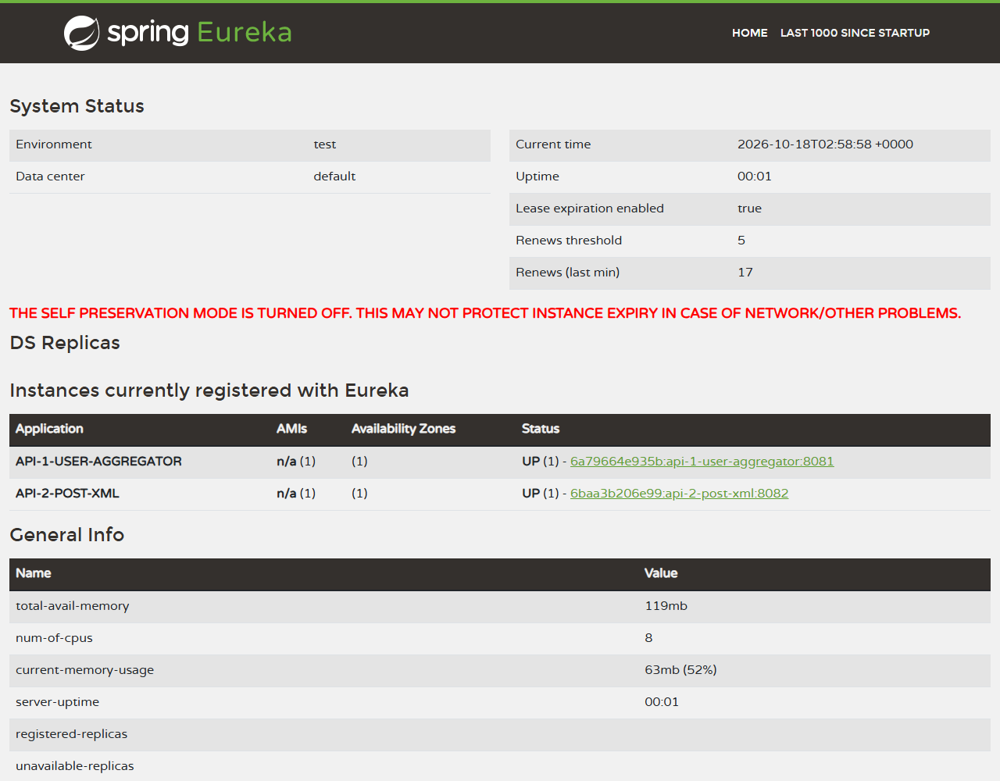

# Bukti jalan (capture) — Spring Boot Microservices Assessment

Dokumen ini menunjukkan alur dari setup sampai hasil output. Semua cuplikan berasal dari output
nyata yang ditangkap pada 18 Oktober 2026 dari commit `09e7bd3` (lihat
[`captures/00-versions.txt`](captures/00-versions.txt)). Berkas mentah ada di
[`captures/`](captures/); skrip penangkapnya adalah [`capture.sh`](capture.sh).

Agar tidak bentrok dengan stack lain di mesin yang sama, penangkapan memakai
`docker compose -p docs-capture` dan `GATEWAY_PORT=18080`. Untuk pemakaian normal, ganti
`localhost:18080` di bawah dengan `localhost:8080` dan hilangkan `-p docs-capture`.

## Alur langkah demi langkah

### 0. Prasyarat

- Docker dengan Compose v2 (diuji: Docker 29.7.2, Compose v5.5.0).
- Port 8080 kosong (atau set `GATEWAY_PORT`).

### 1. Clone

```bash
git clone <repository-url>
cd <repository-directory>
```

Catatan: langkah ini **tidak dijalankan ulang** saat penangkapan; capture dibuat dari git worktree
repo yang sama pada commit `09e7bd3`.

### 2. Build dan jalankan

```bash
docker compose up --build --wait
```

Cuplikan akhir ([`01-compose-up.txt`](captures/01-compose-up.txt)); perintah kembali setelah
semua container sehat. Pada capture ini 92 detik (image Maven sudah ter-cache, jadi bukan build
dingin pertama):

```text
 Container docs-capture-api-2-1 Healthy
 Container docs-capture-gateway-discovery-1 Healthy
 Container docs-capture-api-1-1 Healthy
up --build --wait selesai dalam 92 detik
```

(Baris terakhir ditambahkan oleh `capture.sh`, bukan oleh Docker.)

### 3. Status container

```bash
docker compose ps
```

([`02-compose-ps.txt`](captures/02-compose-ps.txt), kolom dipotong ke yang relevan)

```text
SERVICE             STATUS                    PORTS
api-1               Up 17 seconds (healthy)   8081/tcp
api-2               Up 38 seconds (healthy)   8082/tcp
gateway-discovery   Up 44 seconds (healthy)   0.0.0.0:18080->8080/tcp
postgres            Up 44 seconds (healthy)   5432/tcp
redis               Up 44 seconds (healthy)   6379/tcp
```

Kelima service berstatus sehat, dan hanya gateway yang membuka port ke host.

### 4. Smoke test

```bash
bash scripts/smoke-test.sh            # capture: bash scripts/smoke-test.sh http://localhost:18080
```

([`03-smoke-test.txt`](captures/03-smoke-test.txt))

```text
PASS  users in /api/users: 10
PASS  posts in /api/users: 100
PASS  nested address.geo in /api/users
PASS  indented JSON in /api/users
PASS  todos in /api/users: 200
PASS  rows in /api/posts: 100
PASS  XML declaration in /api/posts
PASS  <root>/<row> with userId, id, title in /api/posts
PASS  indented XML in /api/posts
All checks passed
```

### 5. `GET /api/users` (JSON)

```bash
curl http://localhost:8080/api/users
```

Respons penuh: [`users.json`](captures/users.json); header:
[`04-users-headers.txt`](captures/04-users-headers.txt) (`HTTP/1.1 200`,
`Content-Type: application/json`). Ringkasan yang dihitung dari berkas itu
([`06-users-summary.txt`](captures/06-users-summary.txt)):

```text
user  : 10
todo  : 200
post  : 100
field user pertama : id, name, username, email, address, phone, website, company, todos, posts
field todo pertama : id, title, completed
field post pertama : id, title, body
```

Awal respons (20 baris pertama `users.json`):

```json
[
  {
    "id": 1,
    "name": "Leanne Graham",
    "username": "Bret",
    "email": "Sincere@april.biz",
    "address": {
      "street": "Kulas Light",
      "suite": "Apt. 556",
      "city": "Gwenborough",
      "zipcode": "92998-3874",
      "geo": {
        "lat": "-37.3159",
        "lng": "81.1496"
      }
    },
    "phone": "1-770-736-8031 x56442",
    "website": "hildegard.org",
    "company": {
      "name": "Romaguera-Crona",
```

### 6. `GET /api/posts` (XML)

```bash
curl http://localhost:8080/api/posts
```

Respons penuh: [`posts.xml`](captures/posts.xml) (100 `<row>`, 29.472 byte;
`Content-Type: application/xml;charset=UTF-8`, lihat
[`05-posts-headers.txt`](captures/05-posts-headers.txt)). Dua baris pertama
([`07-posts-first-2-lines.txt`](captures/07-posts-first-2-lines.txt)):

```xml
<?xml version="1.0" encoding="UTF-8"?>
<root>
```

Row pertama ([`07b-posts-first-row.txt`](captures/07b-posts-first-row.txt)):

```xml
  <row>
    <userId>1</userId>
    <id>1</id>
    <title>sunt aut facere repellat provident occaecati excepturi optio reprehenderit</title>
    <body>quia et suscipit
suscipit recusandae consequuntur expedita et cum
reprehenderit molestiae ut ut quas totam
nostrum rerum est autem sunt rem eveniet architecto</body>
  </row>
```

### 7. Eureka dashboard

Buka `http://localhost:8080/` (capture: port 18080).



Dashboard menampilkan `API-1-USER-AGGREGATOR` dan `API-2-POST-XML`, keduanya `UP`. Data JSON
yang sama ada di [`10-eureka-apps.json`](captures/10-eureka-apps.json). Screenshot diambil dengan
Microsoft Edge headless dari stack yang sedang berjalan.

### 8. Pemakaian sumber daya

```bash
docker stats --no-stream
```

([`08-docker-stats.txt`](captures/08-docker-stats.txt); diambil sekitar 5 detik setelah smoke test
dan curl, bukan saat idle lama)

```text
NAME                               CPU %     MEM USAGE / LIMIT     MEM %
docs-capture-api-1-1               9.83%     216.2MiB / 7.677GiB   2.75%
docs-capture-api-2-1               11.00%    238.1MiB / 7.677GiB   3.03%
docs-capture-gateway-discovery-1   2.01%     206.9MiB / 7.677GiB   2.63%
docs-capture-postgres-1            0.05%     56.77MiB / 7.677GiB   0.72%
docs-capture-redis-1               0.26%     6.266MiB / 7.677GiB   0.08%
```

### 9. Bersihkan

```bash
docker compose down -v
```

Hasilnya di [`09-compose-down.txt`](captures/09-compose-down.txt): kelima container, volume
`postgres-data`, dan network dihapus. Setelah itu tidak ada container atau volume `docs-capture`
yang tersisa.

## Perbandingan dengan PDF assignment

Sumber: <https://assignments.streamworx.id/java-spring-boot-assignment-streamworx.pdf>.

| Aspek | Di PDF | Hasil capture | Cocok |
| --- | --- | --- | --- |
| Jumlah service | 5: Gateway/Discovery, API 1, API 2, Redis, Postgres/MySQL | 5 container: `gateway-discovery`, `api-1`, `api-2`, `redis`, `postgres` | Ya |
| Peran API 1 | Output JSON; users dari Redis, todos dari API eksternal, posts dari API 2 menurut diagram | JSON; user dari Redis, todos dari jsonplaceholder, posts via API 2 lewat Eureka | Ya |
| Peran API 2 | Output XML; posts dari Postgres/MySQL | XML dari PostgreSQL 18 | Ya |
| Dibungkus Docker Compose, langsung jalan setelah clone | Ya | `docker compose up --build --wait`, data seed ikut di repo | Ya |
| Layout JSON | Array, indentasi 2 spasi, `"key": value` | Sama: indentasi 2 spasi, `"key": value` (`04`/`users.json`) | Ya |
| Field user | id, name, username, email, address (geo), phone, website, company, todos, posts | Sama persis (`06-users-summary.txt`) | Ya |
| Field todo | id, title, completed | id, title, completed | Ya |
| Field post di JSON | id, title, body | id, title, body | Ya |
| Deklarasi XML | `<?xml version="1.0" encoding="UTF-8" ?>` (terpotong ke 2 baris oleh pembungkus teks PDF; ada spasi sebelum `?>`) | `<?xml version="1.0" encoding="UTF-8"?>` satu baris, tanpa spasi sebelum `?>` | Setara (selisih hanya spasi di dalam deklarasi) |
| `<root>` | Baris baru setelah deklarasi | Baris baru setelah deklarasi | Ya |
| `<row>` | Indentasi 2 spasi, berisi userId, id, title, body (indentasi 4) | Sama | Ya |
| Field XML | userId, id, title, body | userId, id, title, body | Ya |
| Isi `body` | Hanya sampel yang dipotong (teks diringkas, contoh `\n` literal dan terpotong) | Isi penuh dari jsonplaceholder, 100 row | Sengaja berbeda |

Catatan tentang `body`: PDF hanya memuat dua sampel row dan teks `body`-nya dipotong (bahkan
berisi `\n` literal). Data sungguhan yang diminta PDF berasal dari
`jsonplaceholder.typicode.com/posts`, jadi respons ini memakai isi penuh dari sana, bukan
menyalin teks sampel.

## Hasil performa

Sumber: berkas hasil ukur sesi induk (`measure-*.json`, `stress-stress-*.json`), bukan capture
dalam dokumen ini, kecuali tabel `docker stats` di langkah 8.

Kondisi ukur: satu mesin (Intel i5-8300H, 8 CPU), Docker Desktop, klien Python di mesin yang sama.
Angka bersifat indikatif dan tidak mewakili server produksi.

**Konfigurasi JVM.** Compose memakai variabel `JVM_OPTIONS` untuk gateway, API 1 dan API 2
(commit `09e7bd3`). Nilai bawaannya:

```text
-XX:+UseSerialGC -Xmx160m -XX:MaxMetaspaceSize=128m -XX:ReservedCodeCacheSize=48m -Xss512k -XX:TieredStopAtLevel=1
```

Artinya: Serial GC, heap maksimum 160 MB, metaspace dan code cache dibatasi, dan hanya compiler
C1. Ganti dengan `JVM_OPTIONS="..." docker compose up` untuk mencoba nilai lain.

### Start dan sumber daya (rata-rata 2 putaran)

| Metrik | JVM bawaan | `JVM_OPTIONS` baru | Selisih |
| --- | --- | --- | --- |
| Start sampai sehat | 79,3 s | 63,7 s | -19,7% |
| RAM idle (total 5 container) | 974 MiB | 725 MiB | -25,6% |
| CPU sampai sehat | 311 detik CPU | 102 detik CPU | -67% |
| CPU per request `/api/users` | 112,7 ms | 55,1 ms | -51% |
| CPU per request `/api/posts` | 47,2 ms | 20,1 ms | -57% |

Total `docker stats` pada capture ini (216,2 + 238,1 + 206,9 + 56,8 + 6,3 = 723 MiB) konsisten
dengan angka 725 MiB, walau tidak diambil dengan prosedur yang sama.

### Latensi (ms), 300 request berurutan, rata-rata 2 putaran

| Metrik | JVM bawaan | `JVM_OPTIONS` baru | Selisih |
| --- | --- | --- | --- |
| `/api/users` p50 | 77,4 | 73,8 | -4,7% |
| `/api/users` p95 | 127,2 | 109,5 | -13,9% |
| `/api/posts` p50 | 17,4 | 14,2 | -18,4% |
| `/api/posts` p95 | 36,0 | 33,3 | -7,5% |
| `/api/users` request pertama setelah start | 2.464 dan 1.984 | 2.265 dan 2.700 | tidak ada selisih yang jelas |

Angka latensi di tabel ini semuanya dari prosedur yang sama (`measure-*.json`, 300 request
berurutan setelah 20 request pemanasan), jadi bisa dibandingkan langsung. Satu putaran yang lebih
awal memakai prosedur lain (200 request) dan menghasilkan angka yang sedikit berbeda, sehingga tidak
dicampur ke tabel ini.

### Beban 50 paralel (45 detik per fase, satu putaran per konfigurasi)

| Metrik | JVM bawaan | `JVM_OPTIONS` baru |
| --- | --- | --- |
| Error, restart, OutOfMemoryError | tidak ada | tidak ada |
| Puncak RAM total | 1.184 MiB | 795 MiB |
| `/api/posts` throughput | 139 req/s | 150 req/s |
| `/api/posts` p95 (ms) | 594 | 468 |
| `/api/users` throughput | 46,3 req/s | 36,9 req/s |
| `/api/users` p95 (ms) | 1.670 | 1.993 |

**Trade-off.** `JVM_OPTIONS` baru memangkas RAM dan CPU secara jelas dan membuat `/api/posts`
sedikit lebih cepat, tetapi `/api/users` pada beban 50 paralel sekitar 20% lebih lambat
(throughput 46,3 → 36,9 req/s, p95 1.670 → 1.993 ms). Penyebab yang masuk akal adalah C1 saja
dan heap kecil pada endpoint yang banyak mengolah JSON, tetapi itu dugaan, bukan hasil profiling.
Satu putaran per konfigurasi pada beban 50 paralel belum cukup untuk menyatakan selisih
kecil sebagai pasti.

## Yang belum tertangkap

- Screenshot Docker Desktop (tidak diambil; `docker compose ps` dan `docker stats` jadi buktinya).
- `git clone` dari awal dan build dingin pertama (cache Maven sudah ada).
